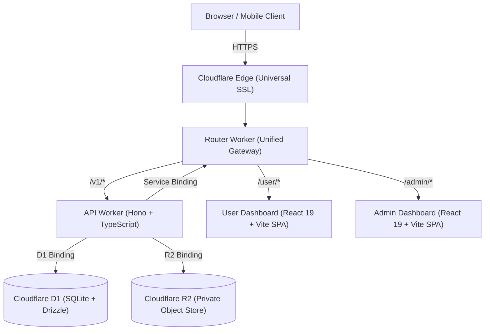

# 🏛️ Production Monorepo Platform Blueprint & Agent Handoff Guide

> **Directive for the Agent:**  
> You are the Lead Systems Architect and Founding Engineer for this new project. Your objective is to build out a production-grade, enterprise-ready full-stack platform using the exact monorepo topology, Cloudflare serverless stack, contract-first design, and exhaustive testing methodology established in the reference **Watchful Ads** platform.
>
> Follow every rule, convention, and quality gate specified in this document. Never compromise on type safety, architectural separation, or test coverage.

---

## 1. High-Level Architecture & Tech Stack



### Core Technologies

| Layer                 | Technology                                            | Purpose & Rationale                                                                      |
| --------------------- | ----------------------------------------------------- | ---------------------------------------------------------------------------------------- |
| **Package Manager**   | `pnpm` (v11+)                                         | Strict workspace isolation, symlinked dependencies, disk efficiency.                     |
| **Monorepo Engine**   | `turbo` (v2+)                                         | Topological task scheduling, remote caching, cross-package pipeline runs.                |
| **Backend Runtime**   | Cloudflare Workers (`workerd`)                        | Instant cold starts, global edge execution, 0ms latency service bindings.                |
| **Backend Framework** | `Hono` (v4+)                                          | Ultra-lightweight, typed routing, factory-based modular architecture.                    |
| **Database**          | Cloudflare D1 + `drizzle-orm`                         | Serverless SQLite at the edge, typed SQL migrations, zero network hops.                  |
| **Storage**           | Cloudflare R2                                         | S3-compatible private object storage with quarantine-and-validate lifecycle.             |
| **Frontend**          | React 19 + Vite 8                                     | Fast HMR, clean functional components, zero-runtime CSS.                                 |
| **API Contracts**     | OpenAPI 3.1 + `redocly`                               | Contract-first source of truth for all types and endpoints.                              |
| **Testing**           | `vitest` + `@cloudflare/vitest-plugin`                | 100% in-memory Workers + D1 + R2 execution; React Testing Library + JSDOM for frontends. |
| **Formatting & Lint** | `prettier` + `eslint` (TypeScript ESLint flat config) | Zero style debates, strict import policies (`consistent-type-imports`).                  |

---

## 2. Monorepo Directory Topology

```
├── .editorconfig
├── .env.example
├── .gitignore
├── .prettierignore
├── AGENTS.md                    <-- Agent governance (no unauthorized git operations)
├── eslint.config.mjs            <-- Root ESLint 9+ flat config
├── package.json                 <-- Root workspace definitions & pipeline scripts
├── pnpm-lock.yaml
├── pnpm-workspace.yaml          <-- Workspace globs (apps/*, packages/*)
├── tsconfig.base.json           <-- Strict TypeScript compiler base options
├── turbo.json                   <-- Pipeline execution definitions
├── .github/
│   └── workflows/
│       ├── ci.yml               <-- PR verification running `pnpm check`
│       └── deploy-production.yml<-- Selective Cloudflare deploy via commit tags
├── apps/
│   ├── api-worker/              <-- Cloudflare Worker API backend
│   │   ├── wrangler.jsonc       <-- Worker bindings (D1, R2, vars, envs)
│   │   ├── vitest.config.ts     <-- In-memory D1 test runner configuration
│   │   ├── src/
│   │   │   ├── app.ts           <-- Hono app composition & route mounting
│   │   │   ├── config.ts        <-- Zod runtime environment validation
│   │   │   ├── types.ts         <-- AppEnv, RuntimeBindings definitions
│   │   │   ├── data/            <-- Database repository abstraction layer
│   │   │   ├── http/            <-- ApiError & standardized JSON error formatters
│   │   │   ├── middleware/      <-- Auth session, CORS, request context
│   │   │   ├── routes/          <-- Modular route factory functions
│   │   │   └── security/        <-- Google Auth, tokens, crypto, CSRF, validation
│   │   └── test/
│   │       ├── setup.ts         <-- Applies real D1 migrations in memory
│   │       └── *.test.ts        <-- Integration tests with simulated requests
│   ├── router-worker/           <-- Single-domain reverse proxy gateway
│   │   ├── wrangler.jsonc       <-- Service binding to api-worker + Pages origins
│   │   └── src/index.ts         <-- Routes /v1 to API, /user and /admin to Pages
│   ├── user-dashboard/          <-- User-facing React 19 SPA
│   │   ├── vite.config.ts       <-- Base path support, dev server proxy
│   │   ├── public/_redirects    <-- Cloudflare Pages SPA rewrite (`/* /index.html 200`)
│   │   └── src/                 <-- Components, router.ts, api.ts, styles.css
│   └── admin-dashboard/         <-- Admin-facing React 19 SPA
│       ├── vite.config.ts
│       ├── public/_redirects
│       └── src/
└── packages/
    ├── config/                  <-- Shared constants, flags, domain config
    ├── contracts/               <-- OpenAPI 3.1 specification & generated types
    │   ├── openapi/v1.yaml
    │   └── src/index.ts
    └── db/                      <-- Drizzle ORM schemas & SQL migration files
        ├── drizzle.config.ts
        ├── migrations/          <-- Numbered SQL migrations (0000_*.sql)
        └── src/
            ├── schema.ts        <-- Drizzle schema definition
            └── schema.test.ts   <-- Verification test for table definitions
```

---

## 3. Essential Root Configuration Files

### `pnpm-workspace.yaml`

```yaml
packages:
  - apps/*
  - packages/*
allowBuilds:
  esbuild: true
  workerd: true
minimumReleaseAgeExclude:
  - "@redocly/cli@2.70.0"
```

### `turbo.json`

```json
{
  "$schema": "https://turbo.build/schema.json",
  "tasks": {
    "build": {
      "dependsOn": ["^build"],
      "outputs": ["dist/**"]
    },
    "lint": {
      "dependsOn": ["^lint"],
      "outputs": []
    },
    "test": {
      "dependsOn": ["^build"],
      "outputs": []
    },
    "typecheck": {
      "dependsOn": ["^typecheck"],
      "outputs": []
    }
  }
}
```

### Root `package.json`

```json
{
  "name": "your-platform",
  "version": "0.0.0",
  "private": true,
  "packageManager": "pnpm@11.9.0",
  "engines": {
    "node": ">=24",
    "pnpm": ">=11.9.0 <12"
  },
  "scripts": {
    "build": "turbo run build",
    "check": "pnpm format:check && pnpm contract:lint && pnpm lint && pnpm typecheck && pnpm test && pnpm build",
    "contract:lint": "redocly lint packages/contracts/openapi/v1.yaml --format=stylish",
    "db:generate": "pnpm --filter @your-org/db db:generate",
    "db:migrate:local": "pnpm --filter @your-org/api-worker db:migrate:local",
    "dev:api": "pnpm --filter @your-org/api-worker dev",
    "dev:user": "pnpm --filter @your-org/user-dashboard dev",
    "dev:admin": "pnpm --filter @your-org/admin-dashboard dev",
    "format": "prettier . --write",
    "format:check": "prettier . --check",
    "lint": "turbo run lint",
    "test": "turbo run test",
    "typecheck": "turbo run typecheck"
  },
  "devDependencies": {
    "@eslint/js": "10.0.1",
    "@redocly/cli": "2.70.0",
    "eslint": "10.13.0",
    "prettier": "3.9.10",
    "turbo": "2.11.10",
    "typescript": "6.0.3",
    "typescript-eslint": "8.72.0",
    "vitest": "5.0.5"
  }
}
```

### `tsconfig.base.json`

```json
{
  "$schema": "https://json.schemastore.org/tsconfig",
  "compilerOptions": {
    "declaration": true,
    "declarationMap": true,
    "forceConsistentCasingInFileNames": true,
    "module": "ESNext",
    "moduleResolution": "Bundler",
    "noUncheckedIndexedAccess": true,
    "skipLibCheck": true,
    "strict": true,
    "target": "ES2022"
  }
}
```

### `eslint.config.mjs`

```javascript
import eslint from "@eslint/js";
import tseslint from "typescript-eslint";

export default tseslint.config(
  {
    ignores: [
      "**/.turbo/**",
      "**/coverage/**",
      "**/dist/**",
      "**/node_modules/**",
      "**/.wrangler/**",
      "**/worker-configuration.d.ts",
    ],
  },
  eslint.configs.recommended,
  tseslint.configs.recommended,
  {
    files: ["**/*.ts", "**/*.tsx"],
    rules: {
      "@typescript-eslint/consistent-type-imports": "error",
      "@typescript-eslint/no-unused-vars": [
        "error",
        { argsIgnorePattern: "^_", varsIgnorePattern: "^_" },
      ],
    },
  },
);
```

---

## 4. Database Layer Pattern (`packages/db`)

### Schema Conventions

- Define all schema tables in `packages/db/src/schema.ts` using `sqliteTable` from `drizzle-orm/sqlite-core`.
- Use integer timestamps in milliseconds (`integer("created_at", { mode: "number" })`).
- Use UUID primary keys generated in application code (`text("id").primaryKey()`).
- Always define explicit foreign key cascades or restrictions (`onDelete: "cascade"`, `onDelete: "restrict"`).
- Handle circular references with care (e.g. if an entity points to an approved revision and the revision points back to the entity, ensure cleanup breaks references first or supports nullable keys).

### Migration Pipeline

- Configure `drizzle.config.ts`:
  ```typescript
  import { defineConfig } from "drizzle-kit";
  export default defineConfig({
    dialect: "sqlite",
    out: "./migrations",
    schema: "./src/schema.ts",
  });
  ```
- Generate migrations via `pnpm db:generate`.
- Migrations are pure SQL files committed to Git under `packages/db/migrations/`.
- In `packages/db/src/schema.test.ts`, write a test that checks that every table object defined in `schema.ts` can be inspected without error.

---

## 5. API Backend Pattern (`apps/api-worker`)

### Architecture Principles

1. **Dependency Injection**: Route creators and apps accept dependencies (e.g., `now: () => number`, `verifyGoogleIdentity`, `fetch`). This enables 100% deterministic, clock-free unit tests.
2. **Repository Abstraction**: All D1 database queries live in `src/data/*-repository.ts`. Routes never execute raw SQL directly.
3. **Structured Error Handling**:
   - Throw typed `ApiError({ code: "...", message: "...", status: 400 })`.
   - Global error middleware formats every error into `{ error: { code, message, requestId, details? } }`.
4. **Zod Validation Middleware**:
   - Validate body JSON, search parameters, and path variables using Zod schemas matching the OpenAPI contract.

### In-Memory D1 Testing with Miniflare (`vitest.config.ts`)

This is the **secret sauce** of this architecture: **fast, 100% in-memory D1 test suites that run without touching the network or Cloudflare servers.**

```typescript
// apps/api-worker/vitest.config.ts
import path from "node:path";
import { cloudflareTest, readD1Migrations } from "@cloudflare/vitest-plugin";
import { defineConfig } from "vitest/config";

export default defineConfig({
  plugins: [
    cloudflareTest(async () => {
      const migrationsPath = path.resolve(import.meta.dirname, "../../packages/db/migrations");
      const migrations = await readD1Migrations(migrationsPath);

      return {
        miniflare: {
          bindings: {
            ADMIN_GOOGLE_SUBS: "test-admin-subject",
            DASHBOARD_ORIGINS: "http://localhost:5173",
            GOOGLE_CLIENT_ID: "test-google-client-id.apps.googleusercontent.com",
            LOG_LEVEL: "error",
            SESSION_TTL_SECONDS: "3600",
            TEST_MIGRATIONS: migrations,
          },
        },
        wrangler: { configPath: "./wrangler.jsonc" },
      };
    }),
  ],
  test: {
    setupFiles: ["./test/setup.ts"],
  },
});
```

And `apps/api-worker/test/setup.ts`:

```typescript
import { env } from "cloudflare:workers";
import { applyD1Migrations } from "cloudflare:test";

// Runs once before all tests: executes real SQL migrations in memory!
await applyD1Migrations(env.DB, env.TEST_MIGRATIONS);
```

### Writing Integration Tests (`test/auth-apps.test.ts`)

```typescript
import { describe, expect, it } from "vitest";
import { env } from "cloudflare:workers";
import { createApp } from "../src/app.js";

describe("Resource API Integration", () => {
  it("creates and retrieves a resource with authorization", async () => {
    const app = createApp({
      now: () => 1700000000000,
      verifyGoogleIdentity: async () => ({
        email: "user@example.test",
        sub: "user-123",
        name: "User Name",
      }),
    });

    const response = await app.request("https://example.com/v1/auth/google-session", {
      method: "POST",
      headers: { "Content-Type": "application/json" },
      body: JSON.stringify({ credential: "dummy-token" }),
    });

    expect(response.status).toBe(200);
    const session = await response.json();
    expect(session.csrfToken).toBeDefined();
  });
});
```

---

## 6. Frontend Dashboards (`apps/user-dashboard` & `apps/admin-dashboard`)

### SPA Routing & Deep Links on Cloudflare Pages

1. **Base Prefix Support**:
   - Provide a `router.ts` module with `parseRoute(pathname, search)` and `formatPath(route, basePrefix)`.
   - Supports both root execution (`/`) and sub-path deployment (`/user`, `/admin`) via `VITE_BASE_PATH`.
2. **Cloudflare Pages Rewrite Rule**:
   - Add `public/_redirects`:
     ```text
     /* /index.html 200
     ```
   - This ensures refreshing deep links (e.g., `/user/campaigns/new` or `/admin/apps`) serves `index.html` instead of HTTP 404.
3. **Frontend Testing Suite (`App.test.tsx`)**:
   - Use `@testing-library/react` and `@testing-library/user-event`.
   - Mock API module with `vi.mock("./api.js")`.
   - In `beforeEach`, isolate JSDOM path state:
     ```typescript
     beforeEach(() => {
       window.history.replaceState(null, "", "/");
       sessionStorage.clear();
     });
     ```
   - Test full user journeys: sign-in, tab switching, form validation, error states.

---

## 7. Single-Domain Gateway (`apps/router-worker`)

When hosting both frontends and the API on a single domain (e.g. `platform.yourdomain.com`):

```typescript
// apps/router-worker/src/index.ts
interface Env {
  API_WORKER: { fetch(request: Request): Promise<Response> };
  USER_PAGES_ORIGIN: string;
  ADMIN_PAGES_ORIGIN: string;
}

export default {
  async fetch(request: Request, env: Env): Promise<Response> {
    const url = new URL(request.url);
    const path = url.pathname;

    // 1. API routes & System endpoints -> Direct Service Binding (0ms latency)
    if (path.startsWith("/v1/") || path === "/v1" || path === "/health" || path === "/ready") {
      return env.API_WORKER.fetch(request);
    }

    // 2. User Dashboard -> Proxy to Cloudflare Pages project
    if (path.startsWith("/user")) {
      return proxyToPages(request, url, "/user", env.USER_PAGES_ORIGIN);
    }

    // 3. Admin Dashboard -> Proxy to Cloudflare Pages project
    if (path.startsWith("/admin")) {
      return proxyToPages(request, url, "/admin", env.ADMIN_PAGES_ORIGIN);
    }

    // 4. Default root fallback
    return Response.redirect(`${url.origin}/user/`, 302);
  },
};

async function proxyToPages(request: Request, url: URL, prefix: string, pagesOrigin: string) {
  const strippedPath = url.pathname.slice(prefix.length) || "/";
  const pagesUrl = `${pagesOrigin}${strippedPath}${url.search}`;
  const proxyRequest = new Request(pagesUrl, {
    method: request.method,
    headers: request.headers,
    body: request.body,
    redirect: "manual",
  });
  return fetch(proxyRequest);
}
```

### Benefits of this Gateway:

- **Zero CORS issues**: Frontend and API share the exact same origin.
- **Cookies work out-of-the-box**: Session cookies flow seamlessly without cross-site third-party cookie restrictions.
- **Single SSL Certificate**: Cloudflare Universal SSL handles the domain and all subdomains automatically.

---

## 8. Continuous Integration & Quality Gate

### The Master Command: `pnpm check`

Every single package must pass all 6 verification stages before code is committed or deployed:

```bash
pnpm check
# Expands to:
# 1. pnpm format:check  (Prettier validation)
# 2. pnpm contract:lint (Redocly OpenAPI validation)
# 3. pnpm lint          (Turborepo ESLint across all packages)
# 4. pnpm typecheck     (Turborepo TypeScript compiler check)
# 5. pnpm test          (Turborepo Vitest unit & integration tests)
# 6. pnpm build         (Turborepo bundle build dry-run)
```

### GitHub Actions CI/CD Pipeline

```yaml
name: Deploy Production Stack

on:
  push:
    branches: [main]
  workflow_dispatch:
    inputs:
      target:
        description: "Component to deploy"
        default: "all"
        type: choice
        options: [all, api, user, admin, router]

concurrency:
  group: production-deployment
  cancel-in-progress: false

jobs:
  deploy-api:
    name: Deploy API Worker & DB
    if: >-
      (github.event_name == 'push' && contains(github.event.head_commit.message, 'deploy_cf:all')) ||
      (github.event_name == 'workflow_dispatch' && (inputs.target == 'api' || inputs.target == 'all'))
    runs-on: ubuntu-latest
    steps:
      - uses: actions/checkout@v4
      - uses: pnpm/action-setup@v4
      - uses: actions/setup-node@v4
        with: { node-version: "24", cache: "pnpm" }
      - run: pnpm install --frozen-lockfile
      - run: pnpm check
      - name: Apply D1 migrations
        run: pnpm --filter @your-org/api-worker exec wrangler d1 migrations apply DB --remote --env production
        env:
          CLOUDFLARE_API_TOKEN: ${{ secrets.CLOUDFLARE_API_TOKEN }}
          CLOUDFLARE_ACCOUNT_ID: ${{ secrets.CLOUDFLARE_ACCOUNT_ID }}
      - name: Deploy Worker
        run: pnpm --filter @your-org/api-worker exec wrangler deploy --env production
        env:
          CLOUDFLARE_API_TOKEN: ${{ secrets.CLOUDFLARE_API_TOKEN }}
          CLOUDFLARE_ACCOUNT_ID: ${{ secrets.CLOUDFLARE_ACCOUNT_ID }}
```

---

## 9. Step-by-Step Implementation Guide for the New Agent

When you initialize this project in your fresh workspace, execute in this exact sequence:

1. **Step 1 — Foundation Setup:**
   - Create root `package.json`, `pnpm-workspace.yaml`, `turbo.json`, `tsconfig.base.json`, `.prettierignore`, `eslint.config.mjs`, `.editorconfig`.
   - Run `pnpm install`.
2. **Step 2 — Contracts & OpenAPI Specification:**
   - Create `packages/contracts/openapi/v1.yaml` with Redocly linting.
   - Export shared TypeScript contracts in `packages/contracts/src/index.ts`.
3. **Step 3 — Database Schema & Migrations:**
   - Create `packages/db` with Drizzle ORM schemas.
   - Run `pnpm db:generate` to produce the first migration file.
   - Write `packages/db/src/schema.test.ts`.
4. **Step 4 — API Worker & Integration Tests:**
   - Create `apps/api-worker` with Hono.
   - Set up `vitest.config.ts` with `cloudflareTest` and `test/setup.ts` applying migrations.
   - Implement repositories, security/auth middleware, and route factories.
   - Write comprehensive integration tests with `app.request(...)`.
5. **Step 5 — Dashboards & SPA Navigation:**
   - Create `apps/user-dashboard` and `apps/admin-dashboard` using Vite + React 19.
   - Add `public/_redirects` and custom `router.ts` for deep links.
   - Add unit tests with React Testing Library (`App.test.tsx`).
6. **Step 6 — Gateway Router Worker:**
   - Create `apps/router-worker` binding to the API worker and proxying Pages origins.
7. **Step 7 — Full Verification:**
   - Run `pnpm check`. Ensure 100% green tests, 0 lint warnings, 0 type errors.
