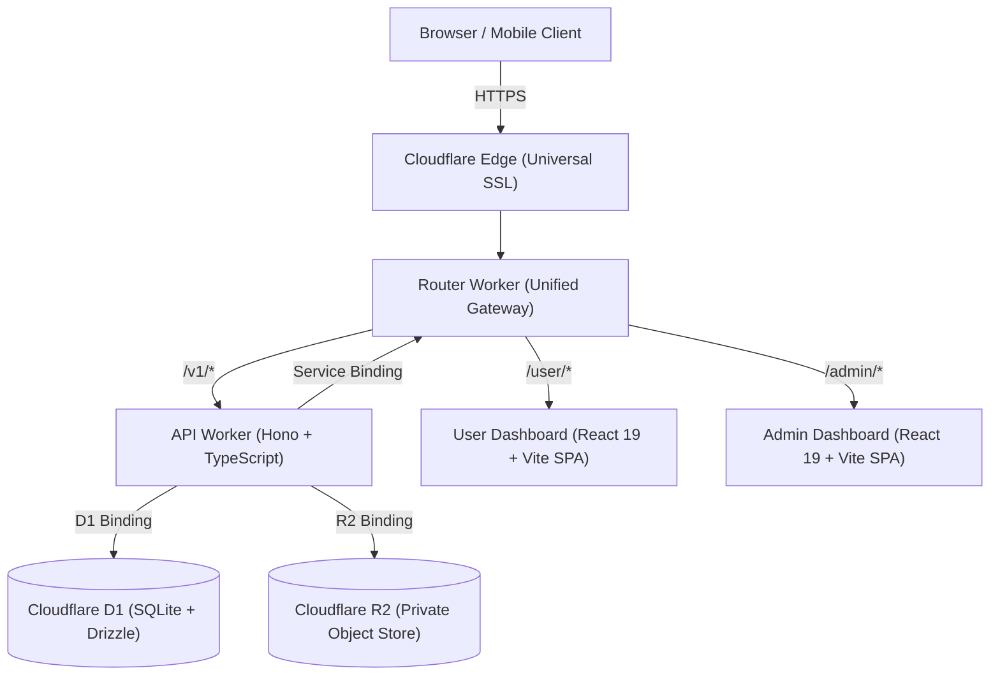

# Foran.pk Seller Central Platform

Production-grade, edge-first seller central platform built with a Cloudflare serverless stack, Drizzle ORM on D1, contract-first OpenAPI 3.1 specification, and React 19 dashboards.

---

## Architecture Overview



### Monorepo Structure

- **`apps/api-worker`**: Cloudflare Worker backend powered by Hono v4 and Drizzle ORM on D1.
- **`apps/router-worker`**: Single-domain reverse proxy gateway using Cloudflare Service Bindings.
- **`apps/user-dashboard`**: React 19 SPA for seller onboarding, store profile, and dashboard.
- **`apps/admin-dashboard`**: React 19 SPA for administrator verification, document inspection, and review queues.
- **`packages/config`**: Shared domain constants, subscription plans, pricing, and document types.
- **`packages/contracts`**: OpenAPI 3.1 contract verified with Redocly CLI and exported TypeScript types.
- **`packages/db`**: Drizzle ORM SQLite schemas and SQL migrations.

---

## Getting Started

### Prerequisites

- **Node.js**: `>=24`
- **pnpm**: `>=11.9.0`

### Installation

```bash
pnpm install
```

### Quality Gate Check

Run all verification stages (formatting, OpenAPI linting, ESLint, TypeScript typecheck, tests, build):

```bash
pnpm check
```

### Local Development

Start the API backend with local D1 and R2 state:

```bash
pnpm dev:api
```

Start the User Dashboard:

```bash
pnpm dev:user
```

Start the Admin Dashboard:

```bash
pnpm dev:admin
```

---

## Database Migrations

Generate new migrations when modifying schema in `packages/db/src/schema.ts`:

```bash
pnpm db:generate
```

Apply migrations locally:

```bash
pnpm db:migrate:local
```

---

## Deployment

Refer to [`CLOUDFLARE_DEPLOYMENT.md`](./CLOUDFLARE_DEPLOYMENT.md) for full instructions on provisioning D1, R2, and deploying the Workers and Pages applications.
